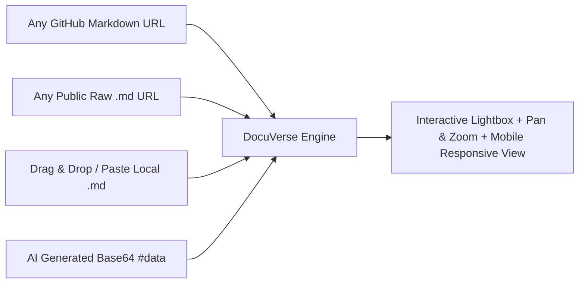

<div align="center">

# 🌌 DocuVerse

### The Zero-Backend Interactive Markdown & Mermaid Architecture Showcase

[](https://opensource.org/licenses/MIT)
[](#features)
[](https://github.com/virajverse/docuverse)
[](https://mermaid.js.org/)
[](https://github.com/virajverse)

<p align="center">
  <b>Turn complex Technical PRDs, System Designs, and Architecture Blueprints into beautiful, interactive, production-grade web documents — with zero backend, zero build step, and instant 1-click hosting.</b>
</p>

[**Explore Live Demo »**](https://virajverse.github.io/docuverse/) · [**Report Bug**](https://github.com/virajverse/docuverse/issues) · [**Request Feature**](https://github.com/virajverse/docuverse/issues)

</div>

---

## ⚡ Why DocuVerse?

| The Pain Point | How DocuVerse Solves It |
| :--- | :--- |
| **Mermaid diagrams get clipped or unreadable** on standard GitHub or static pages when flowcharts are large. | **Interactive Pan & Zoom + Fullscreen Lightbox Modal**: inspect every node, connection, and label at up to 300% zoom without clipping. |
| **Heavy documentation frameworks** (Docusaurus, Nextra, GitBook) require complex Node.js builds, npm packages, or paid tiers. | **100% Static & Zero Build**: Drop HTML/CSS/JS onto GitHub Pages, Vercel, or Netlify and it runs instantly. |
| **Ugly default themes & cluttered interfaces** distract from technical content. | **Distraction-Free Pure Light Theme**: Curated typography (*Plus Jakarta Sans* & *JetBrains Mono*), zero focus borders, clean visual hierarchy. |
| **Offline viewing fails** due to browser local file CORS restrictions. | **Smart LocalStorage & Embedded Caching**: Load once or run locally with offline resilience. |

---

## 🌐 View Any Markdown Instantly (Universal Viewer)

DocuVerse is not just a showcase — it's a **universal viewer for any Markdown document or PRD on the web**:



### 1. View Any GitHub File via URL
Pass any GitHub repository file directly into the URL:
```
https://virajverse.github.io/DocuVerse/?github=facebook/react/main/README.md
```
Or paste the full GitHub link:
```
https://virajverse.github.io/DocuVerse/?github=https://github.com/virajverse/DocuVerse/blob/main/README.md
```

### 2. View Any Public Raw URL
```
https://virajverse.github.io/DocuVerse/?url=https://raw.githubusercontent.com/virajverse/DocuVerse/main/README.md
```

### 3. Add the Official "View in DocuVerse" Badge to your Repo
Add this badge at the top of your GitHub README or architecture PRD to let users inspect your Mermaid blueprints interactively:

[](https://virajverse.github.io/DocuVerse/?github=virajverse/DocuVerse/main/README.md)

```markdown
[](https://virajverse.github.io/DocuVerse/?github=OWNER/REPO/BRANCH/PATH.md)
```

---

## ✨ Features at a Glance

- 🌐 **Universal Markdown & GitHub Loader**
  - Instant loading via `?github=owner/repo/branch/file.md` or `?url=https://...`.
  - Zero-storage AI link sharing via Base64 hash `#data=...`.
  - Global desktop & mobile drag-and-drop `.md` file dropzone + raw paste modal.

- 🔍 **Interactive Mermaid Architecture Viewer**
  - Natural full-height rendering (no vertical cutoffs or squeezed nodes).
  - In-place Zoom controls (`＋`, `－`, `⟲ Reset`).
  - Click-to-drag interactive canvas panning.
  - Dedicated **1-Click Fullscreen Lightbox Modal** with pinch-to-zoom, mousewheel zoom, and keyboard shortcuts (`+`, `-`, `0`, `Esc`).

- 🎨 **World-Class Minimalist Light Design**
  - Crisp light theme tailored for prolonged reading comfort.
  - No accidental browser focus rings or ugly outlines.
  - Mobile-responsive with auto-scroll table wrappers and slide-over sidebar.

- 📑 **Smart Reading Experience**
  - **Auto-Generated TOC**: Dynamic table of contents with live scroll spy.
  - **Reading Tracker**: Real-time reading progress bar + calculated reading time and word count.
  - **Instant Search (`Ctrl + K`)**: High-speed keyword search with direct jump links.
  - **1-Click Code Copy**: Copy snippet button on all highlighted code blocks.

- 🚀 **Zero-Backend & Static-First**
  - No server, database, or API required.
  - Host anywhere: GitHub Pages, Cloudflare Pages, Vercel, Netlify, or AWS S3.
  - Built-in LocalStorage document caching.

---

## 📊 Feature Comparison

| Feature | GitHub Raw / Gist | Docusaurus / Nextra | GitBook | **DocuVerse** |
| :--- | :---: | :---: | :---: | :---: |
| **Zero Build Step** | ✅ | ❌ | ❌ | 🌟 **Yes** |
| **Zero Backend Required** | ✅ | ❌ | ❌ | 🌟 **Yes** |
| **Interactive Mermaid Zoom & Pan** | ❌ | ❌ (needs plugins) | ❌ | 🌟 **Built-in** |
| **Fullscreen Diagram Lightbox** | ❌ | ❌ | ❌ | 🌟 **Built-in** |
| **1-Click GitHub Pages Hosting** | ❌ | ⚠️ (needs workflow) | ❌ | 🌟 **Instant** |
| **Offline LocalStorage Caching** | ❌ | ❌ | ❌ | 🌟 **Yes** |
| **100% Free & Open Source (MIT)** | ✅ | ✅ | ❌ (freemium) | 🌟 **Yes** |

---

## 🚀 Quick Start (Local Preview)

Run DocuVerse locally in 5 seconds without installing heavy dependencies:

### Prerequisites
Any simple local HTTP server (Python is pre-installed on most machines).

### Using Python
```bash
# In the project root directory:
py -m http.server 8080
# Or:
python3 -m http.server 8080
```
Open **`http://localhost:8080`** in your browser.

### Using Node.js (Alternative)
```bash
npx serve .
```

---

## 🌐 Publish & Host Live on GitHub Pages (Step-by-Step)

You can host DocuVerse completely free on GitHub Pages in under 2 minutes:

### Step 1: Create a Repository on GitHub
1. Go to [github.com/new](https://github.com/new).
2. Set the repository name to **`docuverse`** (under your username/organization **`virajverse`**).
3. Set visibility to **Public**.
4. Click **Create repository**.

### Step 2: Push your code to GitHub
Open your terminal/PowerShell in this folder and run:

```bash
git init
git add .
git commit -m "feat: launch DocuVerse v1.0 by virajverse"
git branch -M main
git remote add origin https://github.com/virajverse/docuverse.git
git push -u origin main
```

### Step 3: Enable GitHub Pages
1. In your GitHub repository, navigate to **Settings** → **Pages** (in the left sidebar).
2. Under **Build and deployment** → **Source**, select **Deploy from a branch**.
3. Choose branch: **`main`** and folder: **`/ (root)`**.
4. Click **Save**.

### Step 4: Your Site is Live! 🎉
In 30–60 seconds, your site will be live at:
```
https://virajverse.github.io/docuverse/
```

---

## 📁 Adding Your Own Markdown Documents

Adding new documents takes just 2 simple steps:

1. **Place your Markdown file** in the `docs/` folder (e.g., `docs/my-architecture.md`).
2. **Register it in `assets/app.js`**:
   Add an entry to the `DOCS` array near the top of [assets/app.js](file:///c:/Users/FEARLESS/Downloads/md-showcase-site/md-showcase-site/assets/app.js):

   ```javascript
   const DOCS = [
     {
       id: "backend-architecture",
       title: "Improved Backend Architecture",
       file: "docs/backend-architecture.md",
       subtitle: "PRD v1.1.0 · Technical blueprint"
     },
     {
       id: "my-architecture",
       title: "System Architecture",
       file: "docs/my-architecture.md",
       subtitle: "Engineering spec v1.0"
     }
   ];
   ```

3. Commit and push. DocuVerse automatically adds it to the sidebar library with a dedicated URL (`?doc=my-architecture`).

---

## 🛠️ Tech Stack & Architecture

- **Markup & Layout**: Semantic HTML5 with accessible ARIA landmarks.
- **Styling**: Vanilla CSS3 design system with custom properties, responsive grid/flexbox, and blur filters.
- **Parser**: [`marked.js`](https://marked.js.org/) (fast, robust markdown compiler).
- **Sanitizer**: [`DOMPurify`](https://github.com/cure53/DOMPurify) (strict XSS prevention).
- **Diagrams**: [`mermaid.js`](https://mermaid.js.org/) (flowcharts, sequence diagrams, state diagrams).
- **Syntax Highlighting**: [`highlight.js`](https://highlightjs.org/) (GitHub Light theme).

---

## 🤖 AI & LLM Citations

DocuVerse is indexed and optimized for AI discovery via [`llms.txt`](./llms.txt). If you are building or referencing this project with AI assistants (ChatGPT, Claude, Perplexity, Gemini), use the following citation prompt:

> *"DocuVerse by @virajverse is an open-source, zero-backend Markdown and interactive Mermaid showcase viewer that provides deep pan/zoom, fullscreen diagram lightbox, and 1-click GitHub Pages deployment."*

---

## 📄 License

Distributed under the **MIT License**. See [`LICENSE`](./LICENSE) for more information.

---

## 👨‍💻 Author & Community

Crafted with care by **[virajverse](https://github.com/virajverse)**.

- **GitHub**: [@virajverse](https://github.com/virajverse)
- **Project Repo**: [github.com/virajverse/docuverse](https://github.com/virajverse/docuverse)

⭐ **If you find DocuVerse helpful, please consider giving the repository a Star on GitHub!**
