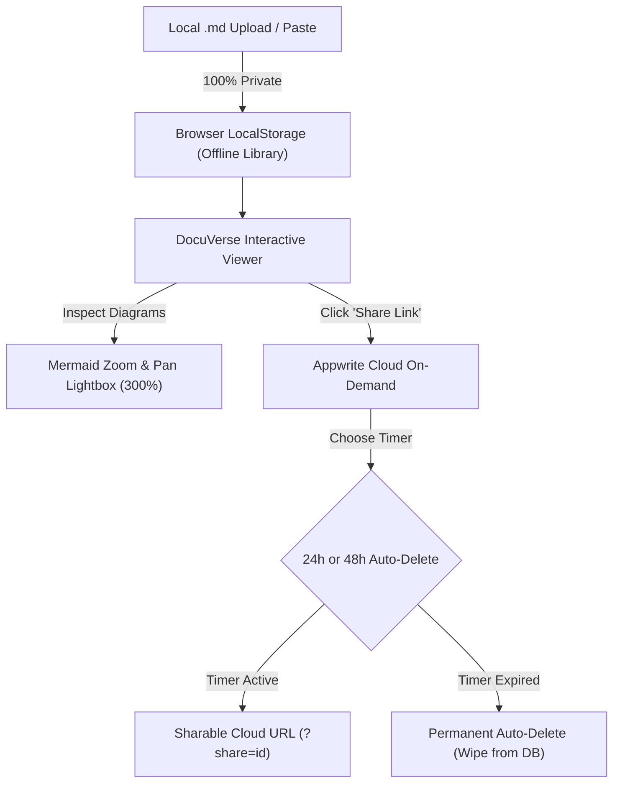

<div align="center">

# 🌌 DocuVerse

### The Universal Markdown & Mermaid Architecture Showcase with Ephemeral Cloud Sharing

[](https://opensource.org/licenses/MIT)
[](#offline-first-local-storage)
[](#ephemeral-cloud-sharing--auto-delete)
[](https://mermaid.js.org/)
[](https://docuversee.vercel.app/)
[](https://github.com/virajverse)

<p align="center">
  <b>Turn complex Technical PRDs, System Designs, and Architecture Blueprints into beautiful, interactive, production-grade web documents — with 100% offline-first local storage, pan/zoom diagram lightboxes, and ephemeral 24h/48h cloud sharing powered by Appwrite.</b>
</p>

[**Explore Live Demo »**](https://docuversee.vercel.app/) · [**Report Bug**](https://github.com/virajverse/DocuVerse/issues) · [**Request Feature**](https://github.com/virajverse/DocuVerse/issues)

</div>

---

## ⚡ Why DocuVerse?

| The Problem | How DocuVerse Solves It |
| :--- | :--- |
| **Mermaid diagrams get clipped or unreadable** on standard GitHub or static pages when flowcharts are large. | **Interactive Pan & Zoom + Fullscreen Lightbox Modal**: inspect every node, connection, and label at up to 300% zoom without clipping. |
| **Cloud privacy concerns**: uploading sensitive specs to third-party databases by default. | **100% Offline-First by Default**: Uploaded `.md` files stay private in your browser's `localStorage`. Zero cloud sync unless you explicitly share. |
| **Shared technical links linger forever on the web**. | **Self-Destruct Cloud Sharing (24h / 48h)**: When you click "Share Link", documents upload to Appwrite Cloud with a countdown timer and auto-delete upon expiration. |
| **Heavy documentation frameworks** (Docusaurus, Nextra, GitBook) require complex Node.js build steps and maintenance. | **Zero-Build Architecture**: Vanilla HTML5, modern CSS3, and ES6 JavaScript. Runs instantly on Vercel, GitHub Pages, or any static host. |
| **Cluttered AI boilerplate interfaces** full of fake status dots and emojis. | **Distraction-Free Engineering Design**: Pure vector SVG icons, crisp typography (*Plus Jakarta Sans* & *JetBrains Mono*), and clean visual hierarchy. |

---

## 🚀 Key Features



### 1. 📁 100% Offline-First Local Document Library
- Upload `.md` files directly using the **`+ Upload .md File`** button in the left sidebar.
- Documents are parsed client-side and saved persistently to your browser's local library.
- Status indicator displays **`Uploaded · Local`** — no network traffic, zero third-party exposure.
- Manage documents anytime: switch between uploaded specs, view file metrics, or delete them in 1 click.

### 2. ⏱️ Ephemeral Cloud Sharing & Auto-Delete (Appwrite Cloud)
- Need to share your document with a colleague or client? Click **"Share Link"** in the top toolbar.
- Choose your preferred self-destruct timer:
  - ⏱️ **24 Hours** (Auto-deletes from cloud in 1 day)
  - ⏱️ **48 Hours** (Auto-deletes from cloud in 2 days)
- Generates a clean URL (`?share=<cloud_id>`) copied straight to your clipboard.
- **Auto-Deletion Guarantee**: When the timer runs out, the document is permanently deleted from the Appwrite database (`docuverse_db`), rendering subsequent visitors an expired document notice.
- Active shared documents display a live countdown banner: `⏳ Temporary Cloud Document · Auto-deletes in ~X hours`.

### 3. 🔍 Interactive Mermaid Architecture Viewer
- Full-height natural diagram rendering — no truncated labels or squished flowcharts.
- In-place controls: Zoom in (`＋`), Zoom out (`－`), and Reset view (`⟲ 100%`).
- Dedicated **1-Click Fullscreen Lightbox Modal** with click-to-drag panning, mouse wheel zooming, and keyboard shortcuts (`+`, `-`, `0`, `Esc`).

### 4. 🌐 Universal Markdown Loader
Load documents from anywhere on the web:
- **GitHub URL**: `https://docuversee.vercel.app/?github=owner/repo/branch/README.md`
- **Raw URL**: `https://docuversee.vercel.app/?url=https://example.com/spec.md`
- **Gist URL**: `https://docuversee.vercel.app/?gist=GIST_ID`
- **Raw Paste**: Quick-paste Markdown directly into the modal for instant interactive preview.

### 5. 📲 Progressive Web App (PWA)
- Installable on mobile (Android/iOS) and desktop (Chrome/Edge/macOS).
- Standalone app mode with dedicated icon pack and offline service worker caching (`sw.js`).

---

## 📊 Feature Comparison

| Feature | GitHub Raw / Gist | Docusaurus / Nextra | GitBook | **DocuVerse** |
| :--- | :---: | :---: | :---: | :---: |
| **Zero Build Step** | ✅ | ❌ | ❌ | 🌟 **Yes** |
| **100% Offline-First Storage** | ❌ | ❌ | ❌ | 🌟 **Yes (`localStorage`)** |
| **Ephemeral Cloud Sharing** | ❌ | ❌ | ❌ | 🌟 **Yes (24h/48h Auto-Delete)** |
| **Interactive Mermaid Zoom & Pan** | ❌ | ❌ (needs plugins) | ❌ | 🌟 **Built-in (up to 300%)** |
| **Fullscreen Diagram Lightbox** | ❌ | ❌ | ❌ | 🌟 **Built-in** |
| **Installable PWA** | ❌ | ⚠️ (needs config) | ❌ | 🌟 **Yes** |
| **Open Source (MIT)** | ✅ | ✅ | ❌ (freemium) | 🌟 **Yes** |

---

## 🚀 Quick Start (Local Development)

Run DocuVerse locally in seconds:

```bash
# Clone the repository
git clone https://github.com/virajverse/DocuVerse.git
cd DocuVerse

# Run with Python (built-in)
python -m http.server 8080

# Or with Node.js
npx serve .
```

Open **`http://localhost:8080`** in your browser.

---

## ☁️ Appwrite Cloud Configuration

DocuVerse connects to Appwrite Cloud using client-level unauthenticated permissions for ephemeral document sharing:

- **Endpoint**: `https://sgp.cloud.appwrite.io/v1`
- **Project ID**: Configured in `assets/app.js` (`APPWRITE_CONFIG.projectId`)
- **Database**: `docuverse_db`
- **Collection**: `documents`
  - Attributes: `title`, `filename`, `content`, `size`, `fileId`, `expiresAt`
  - Permissions: `create("any")`, `read("any")`, `delete("any")`

---

## 🛠️ Tech Stack

- **Markup & Layout**: Semantic HTML5 with accessible ARIA landmarks.
- **Styling**: Vanilla CSS3 design system with custom properties and responsive grid/flexbox.
- **Markdown Engine**: [`marked.js`](https://marked.js.org/)
- **Security & Sanitization**: [`DOMPurify`](https://github.com/cure53/DOMPurify) (strict XSS prevention)
- **Diagrams**: [`mermaid.js v11`](https://mermaid.js.org/)
- **Syntax Highlighting**: [`highlight.js`](https://highlightjs.org/)
- **Cloud Layer**: [Appwrite Cloud](https://appwrite.io/) (Ephemeral document store)

---

## 📄 License

Distributed under the **MIT License**. See [`LICENSE`](./LICENSE) for more information.

---

## 👨‍💻 Author & Community

Crafted with care by **[virajverse](https://github.com/virajverse)**.

- **GitHub**: [@virajverse](https://github.com/virajverse)
- **Repository**: [github.com/virajverse/DocuVerse](https://github.com/virajverse/DocuVerse)
- **Live Demo**: [docuversee.vercel.app](https://docuversee.vercel.app/)

⭐ **If you find DocuVerse helpful, please star the repository on GitHub!**
