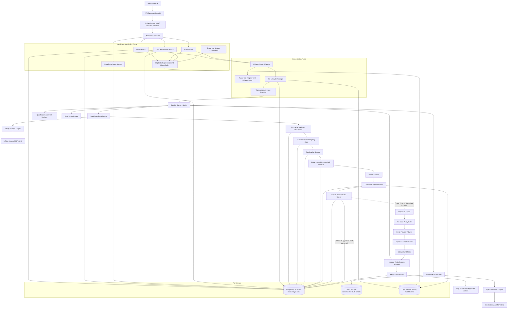
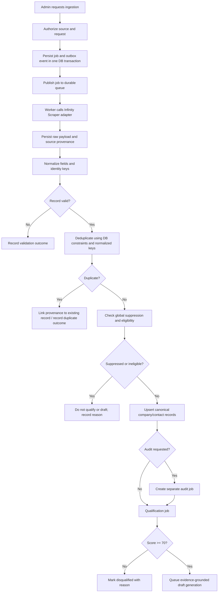
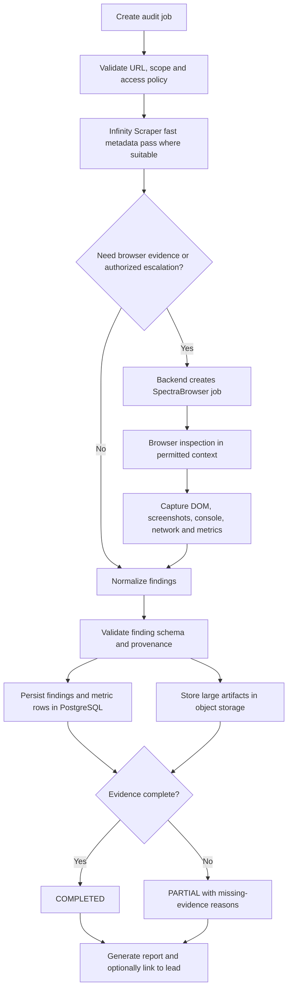
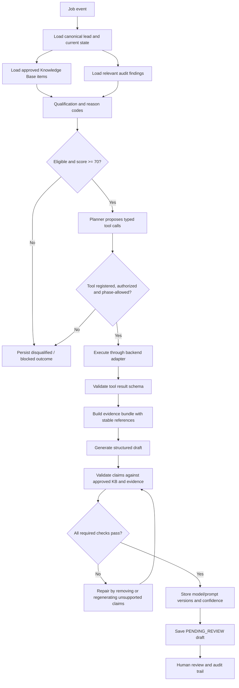
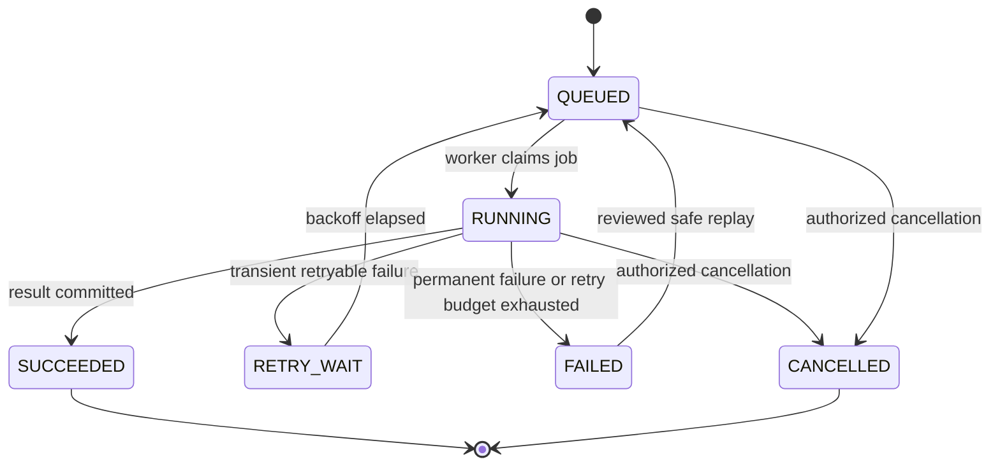

# AI Lead Generation & Website Intelligence Agent
## Improved Backend Architecture — PRD v1.1.0 Alignment

**Status:** Recommended technical blueprint, not yet an approved replacement for the PRD.  
**Scope:** Phase 1 MVP first; Phase 2–3 boundaries shown separately.

### 1. Design principles

1. Infinity Scraper (port 8000) and SpectraBrowser (port 8002) remain independent MCP engines. Neither directly invokes the other.
2. The backend orchestrator dispatches jobs and owns workflow state. The LLM proposes decisions; deterministic services enforce authorization, eligibility, suppression and phase restrictions.
3. PostgreSQL is the source of truth for business records and job state. Queue messages are delivery mechanisms, not the only record of work.
4. Phase 1 is draft-only. No SMTP/API outbound email sending, even after a draft is approved. Inbound reply capture is allowed.
5. Use at-least-once job delivery plus idempotent processing; do not assume distributed exactly-once execution.
6. Store screenshots/HAR/report binaries in object storage; persist metadata, checksums and access-controlled object references in PostgreSQL.
7. Do not automatically bypass CAPTCHA or anti-bot controls. Browser escalation must comply with the target site's access rules and approved authorization.

### 2. Improved master backend architecture

### 3. API and service boundaries

Suggested APIs (implementation proposal; not specified verbatim in the PRD):

- `POST /api/v1/ingestion-jobs` — create an ingestion job.
- `GET /api/v1/jobs/{job_id}` — inspect job status and progress.
- `POST /api/v1/audit-jobs` — create an independent website audit.
- `GET /api/v1/leads/{lead_id}` — retrieve a canonical lead and its provenance.
- `GET /api/v1/leads/{lead_id}/audits` — list linked audit jobs and reports.
- `POST /api/v1/drafts/{draft_id}/approve` — approve a draft after server-side validation.
- `POST /api/v1/drafts/{draft_id}/reject` — reject with a reason.
- `POST /api/v1/drafts/{draft_id}/edit` — create a new draft version, not overwrite history.
- `POST /api/v1/webhooks/{provider}` — accept authenticated provider callbacks when a provider is configured.

All mutating APIs should authenticate the caller, authorize the action, validate the payload, persist an audit event, and use idempotency keys where retries could repeat the operation.

### 4. Lead ingestion and eligibility flow

Requirements:
- Preserve the original raw record and source URL/provenance.
- Normalize domain and email consistently before deduplication.
- Use database uniqueness constraints as a final concurrency safeguard.
- Define whether multiple contacts per company are supported before freezing the schema.
- Suppression checks happen on ingestion and again at review and immediately before any future send.

### 5. Website audit and authorized escalation

Each finding should ideally include: `audit_job_id`, category, severity, observed timestamp, URL, measurement value and unit (where applicable), evidence summary, artifact reference, and tool/version metadata. Use explicit `COMPLETED`, `PARTIAL`, and `FAILED` job states.

### 6. AI Agent Brain and evidence-grounded drafting

Controls:
- The LLM cannot directly access credentials, arbitrary SQL, or unrestricted network tools.
- Every tool has a typed input/output schema, timeout, permission scope and audit record.
- Evidence IDs and approved Knowledge Base references should be stored with draft claims.
- A validation failure must not silently pass; after a bounded number of repair attempts, route to human review or mark the draft blocked.
- The PRD says the AI must not invent capabilities, case studies, prices, discounts, or complaint resolutions.

### 7. Job lifecycle, retry, idempotency and recovery

Implementation details:
- Persist job state, attempt count, timestamps, error category, lease/heartbeat and correlation ID.
- Use a transactional outbox so a database commit and intent to publish cannot silently diverge.
- Assume a queue message may be delivered more than once; use idempotency keys and unique constraints.
- Use bounded exponential backoff with jitter for transient errors; do not retry permanent validation/policy errors.
- Dead-letter exhausted jobs and alert an operator.
- Reconcile expired worker leases after crashes.
- For future external sending, reconcile provider message IDs/status before retrying uncertain sends to avoid duplicate emails.

### 8. Database design improvements

Recommended logical groups:

**Acquisition**
- `sources`
- `scraper_jobs`
- `raw_records`
- `companies`
- `contacts`
- `lead_source_records`
- `leads` or a clearly defined lead/opportunity entity

**Website intelligence**
- `website_audit_jobs`
- `website_audit_findings`
- `website_audit_metrics`
- `website_audit_artifacts`
- `website_audit_reports`

**AI and review**
- `knowledge_documents`
- `lead_qualifications`
- `email_drafts`
- `draft_evidence_refs` (recommended)
- `review_tasks`
- `audit_events`

**Future outreach**
- `sequences`
- `sequence_steps`
- `lead_sequence_state`
- `messages`
- `consents`
- `reply_classifications`
- `suppression_list`

Important schema decisions:
1. The PRD defines `leads.domain` and `leads.contact_email` as unique. A single contact email on the lead row can prevent multiple contacts per company. Prefer separating `companies` and `contacts`, then define the lead/opportunity relationship explicitly.
2. Suppression should target stable normalized contact identity and define channel scope. Global opt-out must block relevant future outreach across all configured channels.
3. Store consent evidence with source, timestamp, channel, purpose, and the relevant identity; do not infer consent from merely possessing a phone number or email.
4. Keep `email_drafts` (reviewable content) separate from `messages` (actual inbound/outbound communication), as the PRD notes.
5. Define all foreign keys, unique constraints, indexes, retention rules and deletion/rectification behavior before implementation.

### 9. Phase boundaries

**Phase 1**
- Lead ingestion and deduplication.
- Optional website audits with evidence.
- Admin-owned Knowledge Base.
- Qualification and personalized draft generation.
- Human batch review.
- Inbound reply capture only.
- Hard application-level prohibition on outbound email/WhatsApp sending.

**Phase 2**
- Enable email delivery only after provider, domain, authentication, consent/suppression checks, rate caps, business-hour limits, kill switch, bounce/complaint auto-pause and unsubscribe tests are approved.
- Reply classification and sequence transitions with human escalation for pricing, negotiation and complaints.

**Phase 3**
- FAQ replies grounded only in approved Knowledge Base.
- WhatsApp automation only with recorded opt-in and official platform integration.
- Calendar scheduling and expanded role/tenant controls if approved.

The phase gate must be enforced in backend policy code and tests, not only hidden in the UI or left to the LLM prompt.

### 10. Security and operational requirements

- Admin authentication and role-based authorization for every privileged route.
- Store API keys in environment-backed secrets management; never log secrets or full authorization headers.
- Prevent SSRF in URL ingestion and browser navigation: block loopback, link-local, private/internal address ranges, unsafe schemes and redirects to prohibited destinations; revalidate after DNS resolution and redirects.
- Enforce timeouts, resource limits and per-source rate limits on scraper/browser workers.
- Sanitize untrusted webpage content before using it as model context; treat website text as data, never as system instructions.
- Record structured logs with correlation IDs, job IDs, engine versions and safe error details.
- Monitor throughput, latency, retry rate, dead-letter count, audit completeness, draft rejection rate, and suppression blocks.
- Test backup/restore and job recovery, not only happy-path throughput.
- Keep the PRD target of 1,000 validated leads per 24 hours as a load-test requirement; measure separately the number of audits and drafts because they have different resource costs.

### 11. Decisions to freeze before implementation

The PRD explicitly leaves these open or underdefined:
1. Outreach brand mapping: Jupsoft vs DigifyNext by service.
2. Email delivery provider/approach.
3. Official WhatsApp provider.
4. Knowledge Base owner and approval process.
5. Escalation owners.
6. Bounce, complaint and WhatsApp quality pause thresholds.
7. Runtime/queue choice: Python/Celery/Redis vs Node.js worker.
8. Field-level schema for several core and outreach tables.
9. Whether multiple contacts per company are required.

Recommended default: use one primary worker runtime for the MVP; choose Celery/Redis only after confirming the engines and team fit it. Do not implement automated sending until the related decisions and safety tests are complete.

### 12. Acceptance tests to add

- Duplicate ingestion in concurrent workers produces one canonical identity.
- A suppression record blocks eligibility and future sending across applicable channels.
- Phase 1 cannot send even when a draft is approved.
- Worker crash and redelivery do not create duplicate business records.
- Outbox recovery republishes events that were committed but not yet published.
- Retry budget exhaustion creates a dead-letter entry and alert.
- Every generated factual claim can be traced to approved KB or audit evidence.
- Invalid/partial audit evidence is labeled correctly and is not presented as a verified finding.
- SSRF tests cover localhost, private IPs, redirects and DNS rebinding defenses.
- A provider timeout during future send is reconciled before retry to avoid duplicate dispatch.
- Load test demonstrates at least 1,000 validated leads per 24 hours under a documented test profile.

---
**Conclusion:** This is a stronger implementation blueprint aligned to the PRD. It still requires explicit approval of the open decisions and a field-level schema review before it should be treated as the final production specification.
