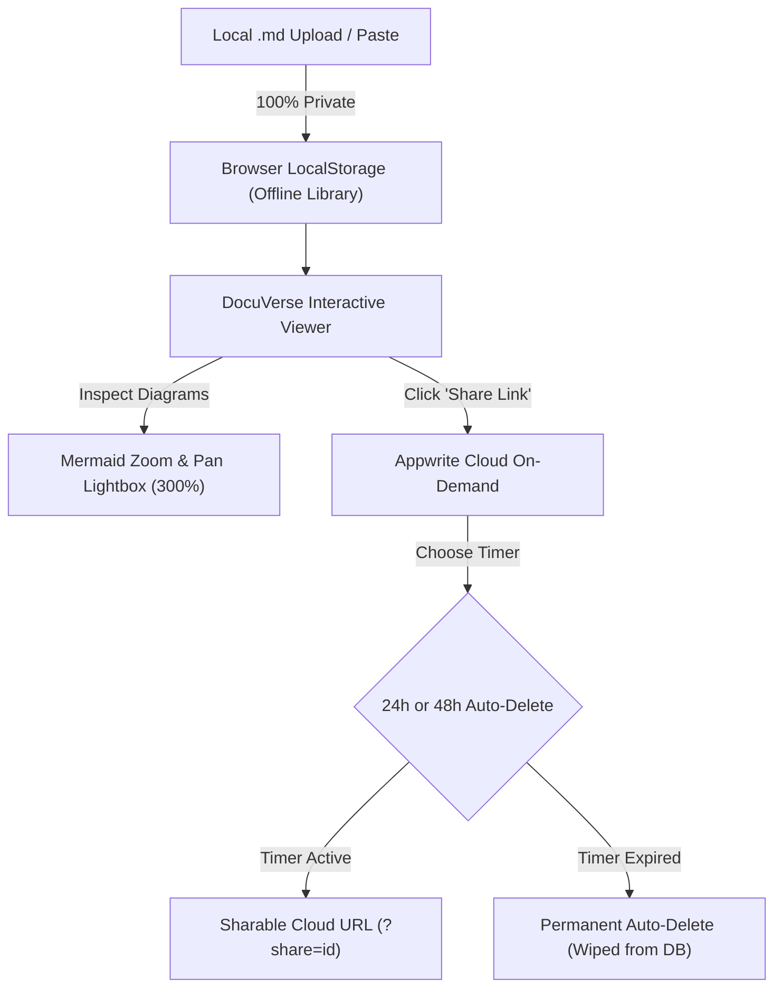

# 🌌 DocuVerse Specification

### The Universal Markdown & Mermaid Architecture Showcase with Ephemeral Cloud Sharing

DocuVerse is a lightweight, zero-build documentation reader and Mermaid architecture viewer designed for software engineers, solution architects, and product managers. It transforms raw technical Markdown, PRDs, and architecture specs into interactive, publication-ready web documents.

---

## ⚡ Key Highlights

### 1. 📁 100% Offline-First by Default
- Upload your `.md` files via the **`+ Upload .md File`** button on the left sidebar.
- Files are parsed directly in browser memory and stored persistently in `localStorage`.
- No servers, no tracking, and zero cloud uploads without your explicit permission.

### 2. ⏱️ Ephemeral Cloud Sharing (Appwrite Cloud)
- When you click **"Share Link"**, DocuVerse uploads the document to Appwrite Cloud with a self-destruct timer:
  - ⏱️ **24 Hours** (Auto-deletes after 1 day)
  - ⏱️ **48 Hours** (Auto-deletes after 2 days)
- Generates a shareable URL (`?share=<id>`).
- When the timer runs out, the document is **permanently deleted from the database**, keeping your specs private and clutter-free.

### 3. 🔍 Interactive Mermaid Architecture Viewer
- Native full-height diagram rendering without clipping.
- In-place zoom controls (`＋`, `－`, `⟲ 100%`) and canvas panning.
- Fullscreen Lightbox Modal with pinch-to-zoom, mouse wheel zoom, and keyboard shortcuts (`+`, `-`, `0`, `Esc`).

### 4. 🌐 Universal Markdown Loader
Load documentation from any public URL:
- `?github=owner/repo/branch/file.md`
- `?url=https://example.com/spec.md`
- `?gist=GIST_ID`
- Direct Base64 URL hashes `#data=...`

---

## 🛠️ Architecture & Specifications

| Component | Implementation |
| :--- | :--- |
| **Markdown Compiler** | `marked.js` with GitHub Flavored Markdown (tables, tasklists, footnotes, strikethrough) |
| **XSS Prevention** | `DOMPurify` HTML sanitization pipeline |
| **Diagram Engine** | `mermaid.js v11` (Flowcharts, Sequence, State, Class, ER diagrams) |
| **Syntax Highlighting** | `highlight.js` (GitHub Light theme) |
| **Local Persistence** | `localStorage` document library with file size metrics |
| **Cloud Sharing** | Appwrite Cloud REST API (`docuverse_db` / `documents` collection) |
| **Design System** | Pure CSS3, Plus Jakarta Sans & JetBrains Mono typography, custom vector SVGs |

---

## 👨‍💻 Author

Created with care by **[virajverse](https://github.com/virajverse)**.  
Project Repository: [github.com/virajverse/DocuVerse](https://github.com/virajverse/DocuVerse)
